# PicoCalc NetThing screenshots

Screenshots of NetThing V1.12A, taken on the PicoCalc itself with the `F5` key (each is the real
320 x 320 screen, saved as a BMP on the SD card and converted to PNG here). They were taken in a public area of a shopping
mall, a good place to see a lot of Wi-Fi and Bluetooth traffic at once: dozens of access points
and, in the Bluetooth scan, over sixty devices heard within a few seconds. The PicoCalc was
connected to two networks while the screenshots were taken: a coffee shop's open network and the
mall's public network.

The PicoCalc's radio supports only 802.11n in the 2.4 GHz band, not 5 GHz or newer standards such as
802.11ac, so only 2.4 GHz networks appear in these Wi-Fi screens.

The top line of every screen says how the PicoCalc is connected (`NOT CONNECTED`, or the network
name with its signal in dBm).

## Contents

- [Start screen](#start-screen)
- [Wi-Fi scan](#wi-fi-scan)
- [Access point details](#access-point-details)
- [Connected](#connected)
- [Bluetooth scan](#bluetooth-scan)
- [Wi-Fi tools](#wi-fi-tools): signal meter, channel survey, health check
- [LAN tools](#lan-tools): DNS checker
- [2.4 GHz crowding report](#24-ghz-crowding-report)

## Start screen

The title screen with the version number. `U` connects with IP over USB, `ESC` or `Q` leaves for the
UF2 Loader menu, and any other key starts scanning.

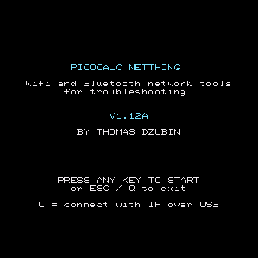

## Wi-Fi scan

The Wi-Fi scan runs over and over by itself. Here it has found 35 access points in the mall, each
with signal bars and dBm, the channel and the security type (`OPEN`, `WPA2`, `WEP` and so on). Hidden
networks show as `<hidden>`. The heading shows how many were found and the time between scans
(`SCANNING  1.0S`); `Left` and `Right` change that time. `Enter` opens the details of the chosen
access point.

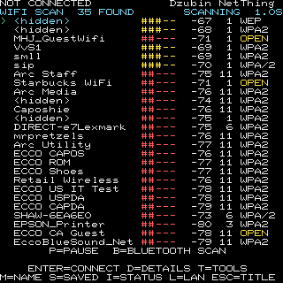

## Access point details

`Enter` (or `D`) on an access point shows everything the scan learned about it, and says whether it
can be connected to. These two screens are the same open network, first heard at -72 dBm
(`WEAK`, in red) and a little later at -66 dBm (`FAIR`, in yellow). `Enter` or `C` connects.

<table>
<tr>
<td>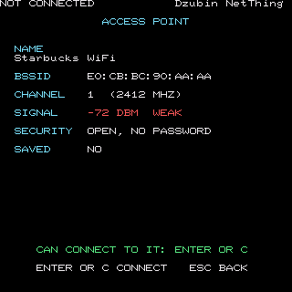</td>
<td>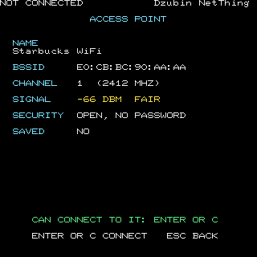</td>
</tr>
</table>

## Connected

After joining, the status screen shows the address, netmask, gateway and DNS server, the
PicoCalc's own MAC address, any IPv6 address, and a strip graph of the signal over the last few
minutes. The first two screens are the coffee shop's network (the first with an empty signal
history, the second with it filled in); the third is the mall's public network.

<table>
<tr>
<td>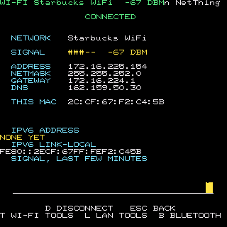</td>
<td>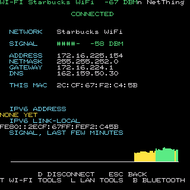</td>
</tr>
<tr>
<td>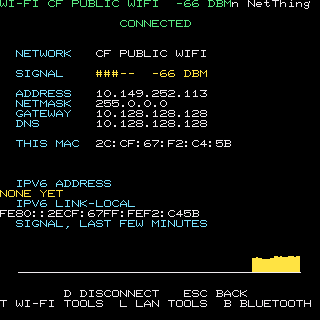</td>
<td></td>
</tr>
</table>

## Bluetooth scan

The Low Energy devices around, strongest first, with signal bars, dBm and what kind of device each
seems to be. Below them is the Classic area (phones, computers, headsets). In the mall the scan
heard 63 Bluetooth devices, most of them Apple devices (shown by maker and the end of their
address, because few give a name). The ones marked `TRACKER` announce themselves as Find My tags, the kind of
device the tracker alert (`T`) and the find tool (`F`) are made for. The heading shows the scan
state and the time between list updates.

<table>
<tr>
<td>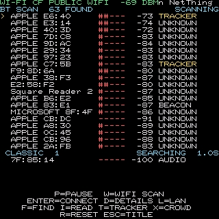</td>
<td>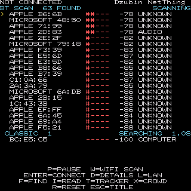</td>
</tr>
</table>

## Wi-Fi tools

### Signal meter

A wide meter that follows the signal of the network the PicoCalc is connected to, with the best and
worst values and a strip of recent readings. Walk about with it to find dead spots. The colour and
the word (`WEAK`, `FAIR`, `GOOD`) follow the signal.

<table>
<tr>
<td>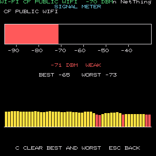</td>
<td>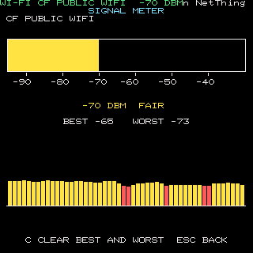</td>
</tr>
<tr>
<td>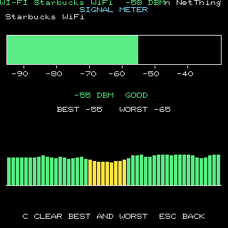</td>
<td></td>
</tr>
</table>

### Channel survey

The strongest signal on each 2.4 GHz channel, as bars or (with `V`) as one hill for every network.
It names the quietest of the three channels that do not overlap (1, 6 and 11), says how crowded the
channel in use is, and lists the strongest networks. Ten networks at the coffee shop, seventeen
at the mall's public network.

<table>
<tr>
<td>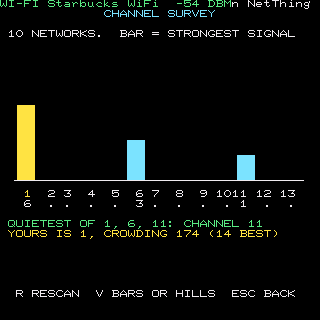</td>
<td>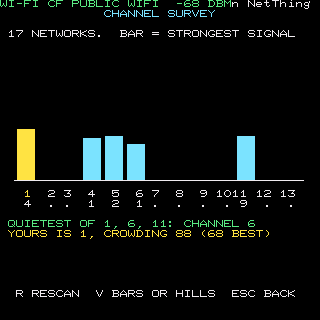</td>
</tr>
<tr>
<td>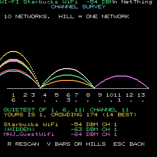</td>
<td>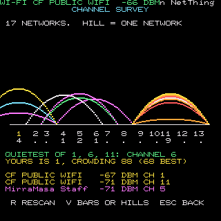</td>
</tr>
</table>

### Health check ("Is it working?")

One screen that checks the signal, the router, DNS, a ping to the internet, the internet connection
and IPv6, each with a coloured light (green is good, yellow is slow or losing packets, red is
failed, blue is for information). The last line sums it up. These two are the coffee shop's
network and the mall's public network. In both the internet connection test is red, and the
summary says "it works, but something is slow or losing packets" (see the yellow lights).

<table>
<tr>
<td>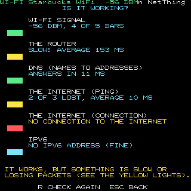</td>
<td>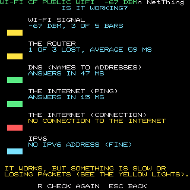</td>
</tr>
</table>

## LAN tools

### DNS checker

Asks the router and three public DNS servers (Cloudflare, Google and Quad9) for the same name,
and shows the answers and the minimum, average and maximum answer times. Any key shows the second
screen, a chart of the answer times.

<table>
<tr>
<td>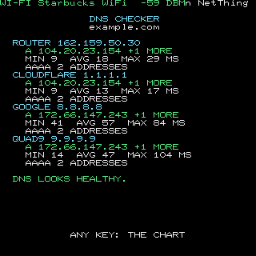</td>
<td>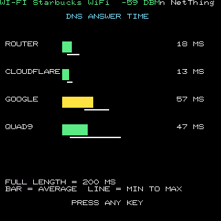</td>
</tr>
</table>

## 2.4 GHz crowding report

Wi-Fi and Bluetooth share the same band, and the same antenna on this chip. The report listens to
both for ten seconds, counts the Wi-Fi networks on each channel and the Bluetooth devices (and how
many are strong), and says whether the band is quiet, busy or crowded, a common cause of a slow link
or choppy audio. At the mall it says `THE 2.4 GHZ BAND IS CROWDED`.

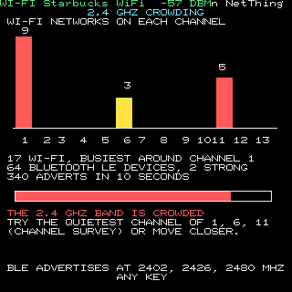
